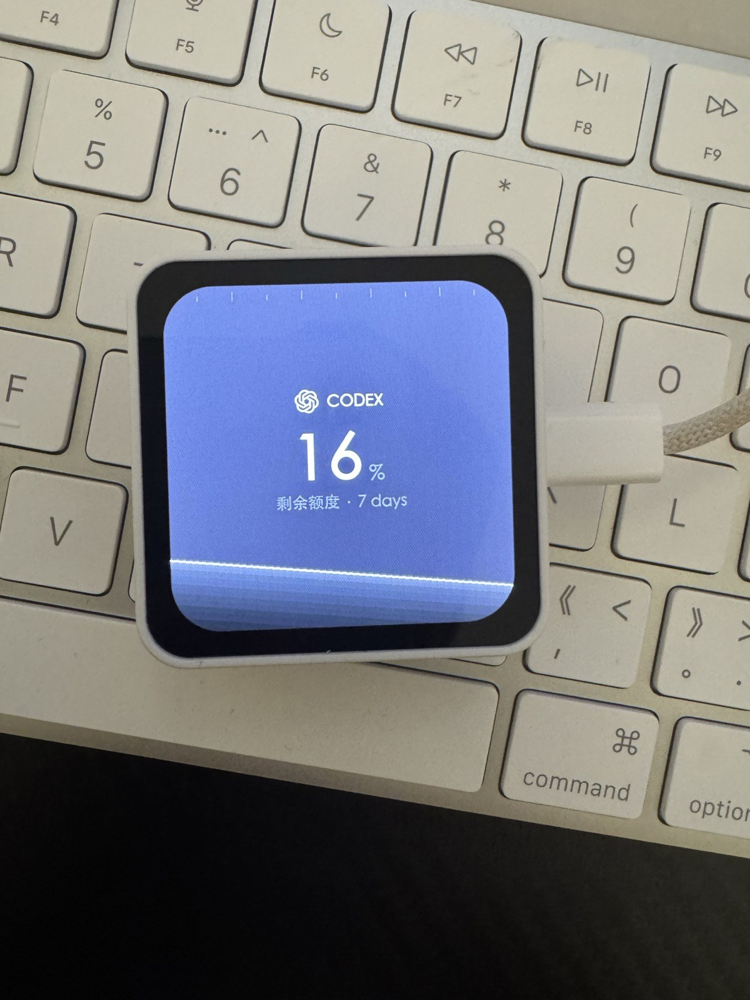
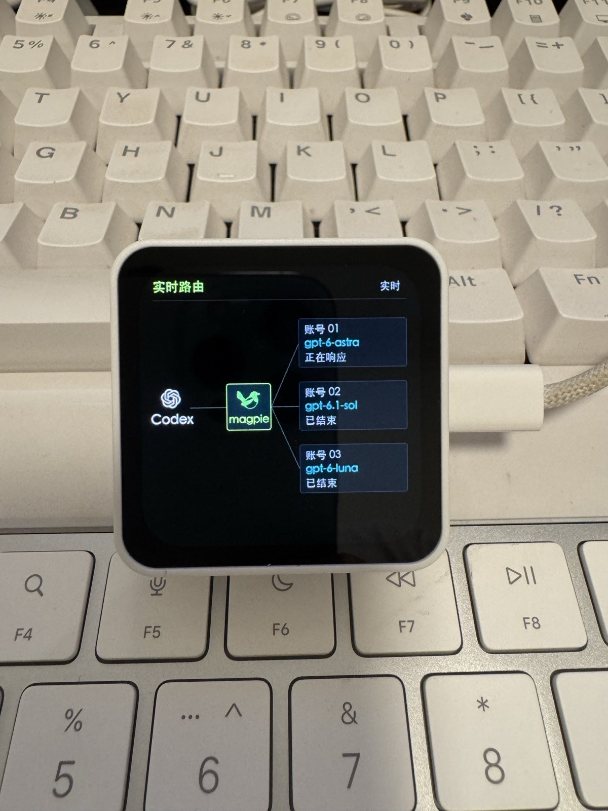
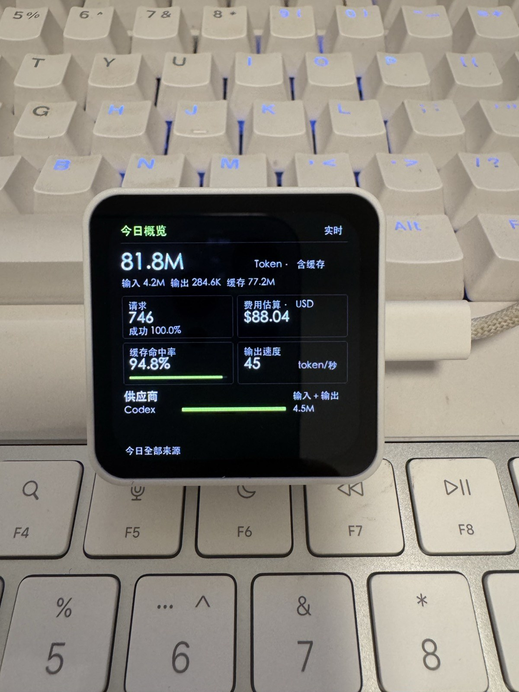

# Magpie Screen

Magpie 的独立 Wi-Fi 数据屏与 Web 预览工具。开发板直接读取 Magpie 的额度、路由和今日用量，原生绘制 480×480 三页画面；日常无需运行 Mac Node 伴随服务。Vue + TypeScript 预览保留用于设计和调试。

## 实机展示

| 液体余量 | 实时路由 | 今日概览 |
| --- | --- | --- |
| [](docs/images/device-quota.jpg) | [](docs/images/device-route.jpg) | [](docs/images/device-overview.jpg) |

Waveshare ESP32-S3-Touch-AMOLED-2.16 实机照片。路由图中的账号使用匿名编号。

## 项目组成

项目包含以下三个部分，目标硬件为 Waveshare ESP32-S3-Touch-AMOLED-2.16：

| 部分 | 技术与职责 | 已实现功能 |
| --- | --- | --- |
| Web 预览 | Vue + TypeScript，用于界面设计与交互调试 | 液体余量、实时路由、今日概览三页预览；真实数据与模拟场景切换、液体黏性与旋转调节、并发路由动画 |
| Web 数据服务 | Node.js + TypeScript，为本机预览采集与整理 Magpie 数据 | 额度、路由与今日用量的只读代理；会话发现、增量事件处理、账号匿名化、设备配置页跳转 |
| 开发板固件 0.3.20 | C++ + Arduino，PlatformIO 构建，通过 Wi-Fi 独立采集与原生分块渲染 | 三页显示与实体按键切换、液体重力运动、连续路由动画、停稳后内容翻正；充电模式、设备端配置、热点配网、OTA、USB / 电池亮度与熄屏策略 |

日常仅需开发板联网，并保持 Magpie 服务可访问；Magpie 可以运行在 Mac 或其他主机。三页固件与操作说明见 [firmware/](firmware/README.md)。当前使用 Wi-Fi，未接入 BLE。原生固件保留三页数据功能与液体运动，文字与图标在旋转停稳后按 90° 翻正。

## 烧录前备份

首次烧录自定义固件前，请先备份开发板的整片 Flash，保留原出厂程序、资源、分区表和持久化配置。新固件通常会替换出厂界面及其功能。

可使用 esptool 的 `read-flash 0 ALL` 读取整片镜像，并校验文件大小及与设备 Flash 的一致性。建议将镜像、设备信息、校验值和恢复步骤保存在项目内的 `device-backups/` 目录；该目录已加入 `.gitignore`。备份可能包含 Wi-Fi 密码等配置，请仅在本地保管。恢复时使用匹配的工具命令，将完整镜像写回同一块板子的 `0x0` 地址；镜像不包含 eFuse 或外置 SD 卡数据。

固件支持 Wi-Fi OTA：首次通过 USB 烧录，配网后可通过配置页上传应用固件。分区调整或故障恢复仍可能需要 USB。

## Web 预览安装与运行（可选）

需要 Node.js 22.18 或更新版本。

```sh
npm ci --registry=https://registry.npmjs.org
npm run build
npm start
```

打开 [http://127.0.0.1:4173](http://127.0.0.1:4173)。服务仅监听回环地址。前台运行时按 Ctrl-C 停止。开发模式使用 `npm run dev`，启动前应先停止占用同一端口的服务。

开发板独立运行不需要 Python；如需使用可选 USB 桥接，请安装 Python 3 和 pyserial，并可通过 `MAGPIE_PYTHON` 指定解释器。

运行测试：

```sh
npm test
```

## 开发板配置

访问 `http://开发板IP/config` 或 [magpie-screen.local/config](http://magpie-screen.local/config)。长按右侧 GPIO18 按键 3 秒，屏幕显示地址、配置访问码和临时热点信息。首次配网使用手机连接该热点，访问 [192.168.4.1/config](http://192.168.4.1/config)，填入 2.4 GHz Wi-Fi、Magpie 局域网地址及 API Key。

Magpie 需开启「在局域网上共享」，API Key 需允许读取额度、用量和路由。配置和凭据保存在开发板 NVS，页面不回显密钥；已有 Wi-Fi 与旧配对密钥保留。设备端设置支持供应商、账号、窗口、黏性、水平校准偏移量、后台调用过滤、路由真实账号显示、独立 USB / 电池亮度、熄屏时间和无线固件更新。

立放静置后液面仍倾斜时，可按三个按钮朝上、右、下、左分别调整水平校准角度，操作与作用范围见 [静置时液面倾斜的校准](firmware/README.md#静置时液面倾斜的校准)。

默认 USB 70% 亮度、5 分钟无活动熄屏；电池 40% 亮度、30 秒调暗、2 分钟熄屏。USB 常亮默认关闭，开启时页面提示 OLED 烧屏风险。熄屏暂停绘图，联网继续；按键、触摸、明显移动可唤醒，USB 默认也允许新业务活动唤醒。

三个实体键短按切换 1 / 2 / 3 页，熄屏后首次短按只唤醒。PWR 长按关机行为保留。完整操作与测试说明见 [固件说明](firmware/README.md)。网页的“设备配置”入口在新标签页打开开发板配置页，旧 `/config` 地址也会跳转到设备，优先使用已发现的设备 IP，未发现时使用 `magpie-screen.local`。

### 充电模式

USB 接入时可手动进入充电模式：

1. **进入**：接入 USB，长按第一个实体键（BOOT / GPIO0）3 秒。面向屏幕、USB 在下方时，它位于顶部最左侧；进入后松手即可。
2. **显示**：黑底中央仅显示电池百分比，亮度固定为 **20%**，持续亮屏；不显示液体、图标或其它文字。
3. **退出**：按任意实体按键或拔掉 USB，返回进入前的正常页面，并恢复对应电源的亮度与熄屏设置。退出按键不会同时切页或开启配网。

USB 插拔通过 AXP2101 的电源事件处理，事件标志每 50 ms 读取一次；电池百分比每秒刷新。无有效电量读数时显示 `--%`；重启后恢复正常页面。更多行为见 [固件充电模式说明](firmware/README.md#充电模式)。

## 预览功能

- **模拟模式**：闲置、未完成、成功、失败、空数据和离线场景；可配置 1–4 个并发请求及 1–4 个目的地，手动播放一次模拟事件。
- **真实模式**：发现或手动选择会话、查看全部会话活动、过滤辅助调用，以及暂停和重连。
- **视图**：液体余量、路由动画、今日概览。数据适配器和画面组件独立，可分别扩展。

## 路由与动画

目的地仅来自实际尝试记录。同一账号的不同模型分行，并发请求保留独立事件身份；活跃目的地优先显示，更多记录在控制台列出。

动画由监控到的状态变化触发：

1. 新请求：客户端飞向 Magpie。
2. 新尝试：Magpie 飞向实际目的地。
3. 首次响应或尝试结束：目的地飞回 Magpie。
4. 请求结束：Magpie 飞回客户端。

所有请求完成且连续 **10 秒**没有新路由活动时，开发板与网页路由图清空目的地、返回等待状态；未完成请求继续保留，重复轮询不续期。这只影响画面，不删除 Magpie 历史。

每个事件只播放一次。等待期间保持静止，首次连接、重连和会话切换只同步基线，不重放历史。动画不表示生成进度，也不逐包重现网络传输。

同一请求的飞行各段依次播放：客户端 → Magpie → 目的地，响应时目的地 → Magpie → 客户端；前一段到达后再开始下一段。不同请求仍可同时播放。

## Magpie 接口

Web 预览的上游地址固定为 [http://127.0.0.1:3425](http://127.0.0.1:3425)。代理只执行读取操作，不调用模型接口。独立固件使用设备配置中的局域网地址。

| 接口                                                   | 用途                      |
| ------------------------------------------------------ | ------------------------- |
| `GET /api/hello`                                       | 网关连接状态              |
| `GET /v1/magpie/quotas`                               | 账号额度窗口与剩余比例    |
| `GET /v1/magpie/usage?period=today`                    | 今日用量与计时汇总        |
| `GET /v1/magpie/usage/requests?period=today&limit=100` | 从近期 Codex 请求发现会话 |
| `GET /v1/magpie/trace?after=<seq>&wait=1`              | 增量路由事件              |
| `GET /v1/magpie/route?session=...`                     | 单会话最新路由            |

trace 接口在 `wait` 非空时固定等待最多 25 秒，代理超时为 30 秒。客户端按请求 ID 合并增量、移除过期记录，并在网关进程或序列变化时重置。会话发现仅覆盖近期记录，不是完整会话目录。

独立固件 USB 供电时，额度/用量/路由分别约每 10/15/1 秒读取；电池亮屏时每 30 秒、熄屏时每 60 秒读取。网络任务串行执行，慢响应会延长间隔。trace 返回 403 时回退到会话模式，每 10 秒从当日最近 100 条请求发现最多四个会话；短请求可能跳过中间状态。

`done:false` 只表示未完成；已完成的 HTTP 2xx 请求显示成功，记录的错误显示失败。无路由数据与接口不可达分别显示。

账号默认匿名：网页可通过本机开关显示账号名称，开发板通过配置页“显示真实账号”控制；接口不提供可靠账号时保留编号。账号映射和会话标识只在内存中处理。代理排除请求正文、提示词、文件路径、原始错误文本及原始账号标识；本地配置与运行产物不纳入 Git。

## 液体余量与旋转预览

第一页默认展示真实 Magpie 额度，可切换模拟预览：Codex 黑白调液体（银灰液面与墨黑渐变）、Claude 橙色液体。控制台可选择账号和额度窗口、调整黏性和设备角度，模拟模式还可手动调整余量。也可直接左右拖动设备旋转，支持左右转 90°、倒置、归零、轻晃。

液面在屏幕坐标中响应重力，使用带阻尼的惯性和相邻液面节点之间传播、反射的波动；通过裁剪多边形和面积求解保持液量。停止旋转后等待稳定，再把三页内容以 420 ms 过渡翻到最近的主要阅读方向。液体独立运动，不随文字翻正。临界角度设有缓冲，避免反复翻身。

真实额度通过本地 `/api/quotas` 代理读取 Magpie `/v1/magpie/quotas`，页面可见时每 30 秒刷新。液位对应所选账号与窗口的剩余百分比，控制台显示采集时间和窗口重置时间。账号及窗口选择在刷新时保留；缺失数据或读取失败显示“—”，不使用模拟数据填充。账号展示名称仅在本机页面用于选择。网页姿态仍由控制台模拟，不读取硬件 IMU。

## 今日概览

第三页合并今日用量与概览：含缓存 Token 总量、输入/输出/缓存拆分、请求和成功率、费用估算、缓存命中率、输出速度，以及最多三行供应商的输入加输出分布（超过三家时保留前两家，其余合并）。重试和计时样本等细项在控制台展示。读取今日全部来源，每 15 秒刷新，与路由会话选择独立。

Token 总量为输入、输出、缓存读取与缓存写入之和。缓存命中率为缓存读取占提示词总量的比例。输出速度按有效计时的输出 Token 总数除以总输出时长计算；只有速度下限时使用“≥”。供应商横条使用输入加输出 Token，不含缓存，因此和顶部总量口径不同。

费用为已计价 USD 估算，不代表账单或剩余额度，未计价调用单独提示。缺失数据和无有效计时显示“—”；没有调用时显示零，接口不可达时不填入模拟数据。

## 结构与显示设备

- `server.mjs`：本地采集与响应字段过滤。
- `src/types.ts`：屏幕状态与事件映射。
- `src/RouteGraph.vue`：目的地和有限次事件动画。
- `src/RouteScreen.vue`：屏幕展示。
- `src/LiquidScreen.vue`、`src/liquid.ts`：液体画面与面积守恒、黏性模拟。
- `src/useDeviceMotion.ts`：设备旋转、停稳判断和内容翻正。
- `src/OverviewScreen.vue`：数据概览。
- `src/App.vue`：预览控制和连接生命周期。

Web 画布用于界面设计。0.3 原生固件独立读取 Magpie HTTP 接口，将数据变化转为本地动画，无需传输整帧或依赖浏览器。

Web 预览第三页顶部通过本地设备状态接口每 2 秒读取实机电量与充电状态，充电时显示绿色闪电标记；未连接设备、未安装电池或读数无效时显示 `—%`，模拟模式也不伪造电量。

## 参考与许可证

- [Magpie](https://github.com/yetone/magpie)：接口、图标与喜鹊矢量素材，MIT。
- [Magpie Usage Display](https://github.com/peterroe/magpie-usage-display)：显示设备与伴随程序架构参考，MIT。

本项目原创部分采用 [Magpie Screen 个人非商业使用许可](LICENSE)：**个人非商业使用免费，商业使用必须事先取得书面授权**。个人学习、自用及非商业修改分享允许免费进行；公司内部业务、客户交付、收费服务及预装硬件销售等须另行授权。商业授权请通过 [GitHub Issues](https://github.com/sywyyhykkk/magpie-screen/issues) 联系维护者。

这是附带使用限制的源码可见许可。此前已依 MIT 发布的材料仍遵循其原许可；第三方代码、依赖、字体与图标继续适用各自许可证，详见 [THIRD_PARTY_NOTICES.md](THIRD_PARTY_NOTICES.md) 和 `LICENSES/`。产品名称及标识属于各自权利人，本项目为社区兼容工具。
